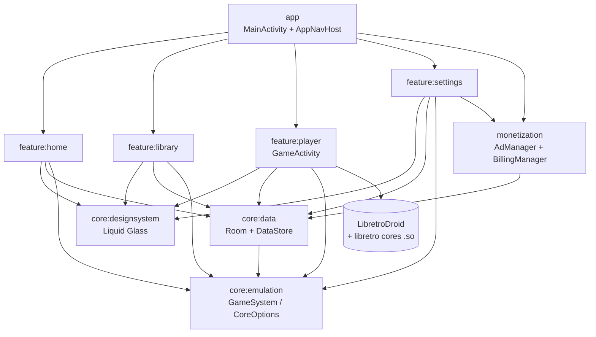
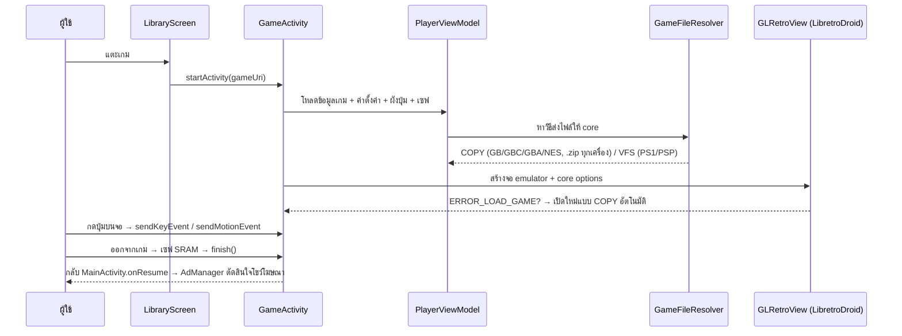

# สถาปัตยกรรมของ ALL Emulator

เอกสารนี้อธิบายว่า "โค้ดแต่ละส่วนทำอะไร และคุยกันยังไง" เพื่อให้แก้ไขได้โดยไม่งง
ถ้าอยากดูแบบภาพรวมเชิงโต้ตอบ ให้เปิด `graphify-out/graph.html` ในเบราว์เซอร์

## 1. ภาพรวมโมดูล

**กฎ:** feature ไม่เรียกกันเอง — ทุกการเปลี่ยนหน้าผ่าน `app/AppNavHost.kt`

## 2. ไฟล์สำคัญ — "อยากแก้ X ไปที่ไฟล์ไหน"

| อยากแก้... | ไฟล์ |
|---|---|
| เพิ่ม/แก้เครื่องเกม, นามสกุลไฟล์ที่รับ, สีการ์ด | `core/emulation/.../GameSystem.kt` |
| ตำแหน่งปุ่มเริ่มต้น | `core/emulation/.../ControllerLayouts.kt` |
| โหมดความลื่น → ค่าของ emulator | `core/emulation/.../CoreOptions.kt` |
| สีธีม / ความเบลอของกระจก | `core/designsystem/.../theme/Theme.kt`, `glass/Glass.kt` |
| ไอคอนเครื่องเกม | `core/designsystem/.../icons/ConsoleIcon.kt` |
| หน้าแรก | `feature/home/.../HomeScreen.kt` |
| หน้ารายการเกม / ปุ่ม + | `feature/library/.../LibraryScreen.kt` |
| การสแกนโฟลเดอร์ | `core/data/.../scan/GameScanner.kt` |
| หน้าเล่นเกม, เมนูหยุด, เซฟ, บอดี้เครื่อง Nintendo | `feature/player/.../GameActivity.kt`, `PlayerOverlays.kt` |
| ตั้งค่าระหว่างเล่น (เมนูหยุด → ตั้งค่า) | `feature/player/.../InGameSettings.kt` |
| เลือกไฟล์ / แตก .zip อัตโนมัติ | `core/data/.../GameRepository.kt` → `importFiles`, `GameFileResolver.kt` |
| รูปไอคอนเครื่องเกม (ตัดพื้นหลัง+ลบโลโก้) | `core/designsystem/src/main/res/drawable-nodpi/console_*.png`, `scripts/make-console-icons.py` |
| การส่งไฟล์เกมให้ emulator | `feature/player/.../GameFileResolver.kt` |
| จอยบนจอ | `feature/player/.../gamepad/VirtualGamepad.kt` |
| หน้าแก้ไขผังปุ่ม | `feature/player/.../gamepad/LayoutEditor.kt` |
| FPS/CPU/GPU overlay | `feature/player/.../PerformanceMonitor.kt` |
| ความถี่โฆษณา (1 ชม.) | `monetization/.../AdManager.kt` → `AD_INTERVAL_MS` |
| สินค้าลบโฆษณา | `monetization/.../BillingManager.kt` → `PRODUCT_ID` |
| รหัส AdMob, เวอร์ชันแอพ | `app/build.gradle.kts` |

## 3. เส้นทางตอนกดเล่นเกม

## 4. การเก็บข้อมูล

| ข้อมูล | ที่เก็บ | ไฟล์โค้ด |
|---|---|---|
| รายชื่อเกม, โฟลเดอร์, เกมล่าสุด, ติดดาว | Room `all_emulator.db` | `core/data/db/*` |
| ความลื่น / overlay / ผังปุ่ม (ต่อเครื่อง) | DataStore (JSON) | `SettingsRepository.kt` |
| ซื้อแล้วหรือยัง, เวลาโฆษณาล่าสุด | DataStore | `SettingsRepository.kt` |
| เซฟในเกม (.srm) | `files/saves/<เครื่อง>/` | `PlayerViewModel.kt` |
| save state 4 ช่อง | `files/states/<เครื่อง>/` | `PlayerViewModel.kt` |
| BIOS + ไฟล์ระบบของ core | `files/system/` | `SystemAssets.kt`, `SystemSettingsScreen.kt` |

## 5. Liquid Glass ทำงานยังไง

1. `GlassScaffold` วาด `LiquidBackground` (หยดสีลอยไปมา) และลงทะเบียนเป็น **ต้นทาง** ของ Haze
2. ทุก `Modifier.glass()` อ่านภาพต้นทางมา **เบลอ** + เคลือบสีขาวโปร่ง + ขอบสะท้อนแสง
3. Android 12+ เบลอจริง (RenderEffect) / Android 8–11 ใช้สีทึบโปร่งแทนอัตโนมัติ (`fallbackTint`)

## 6. ข้อจำกัดที่ควรรู้

- **GPU %**: Android ส่วนใหญ่ไม่อนุญาตให้แอพอ่าน → overlay แสดง `N/A` + เวลาต่อเฟรม
- **Android 11+**: ผู้ใช้เลือกโฟลเดอร์ `Download` ตรงๆ ไม่ได้ (ระบบห้าม) ต้องสร้างโฟลเดอร์ย่อย เช่น `Download/Games`
